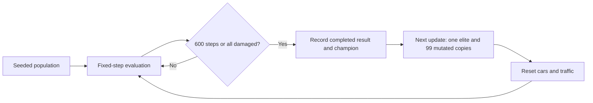

# Evolutionary controller search

[Learning guide](README.md) · [User manual](usage.md) · [Measured examples](results.md)

## Theoretical context

A controller can be evaluated by running it in an environment and assigning a score to its behavior. Searching over neural network parameters in this way is neuroevolution. It evaluates whole candidate controllers rather than computing a gradient for each driving action. Poole and Mackworth introduce this viewpoint in [Evolutionary Algorithms](https://artint.info/3e/html/ArtInt3e.Ch13.S2.html).

Population-based search maintains multiple candidates and produces new candidates using their evaluated performance. Mutation creates variation; preserving an elite retains a known candidate. Classical genetic algorithms may also combine parents through crossover, described in [Population-Based Methods](https://artint.info/3e/html/ArtInt3e.Ch4.S7.html). This application uses one parent plus mutation and elitism, without crossover, tournament selection, backpropagation, or gradient updates.

The original [Radu Mariescu-Istodor course](https://github.com/gniziemazity/self-driving-car) includes interpolation-based neural network mutation in its optimization lesson. This repository uses the same teaching idea, adding explicit seeded randomness, independent copies, bounded automatic generations, and measured comparisons. See [attribution](attribution.md).

## Candidate representation

Each car has the [5–6–4 controller](neural-network.md): 54 weights and 10 biases. These 64 numeric parameters are the candidate. Sensor observations and activation arrays change during inference; the candidate parameters do not change while that car is evaluated.

[main.js](../assets/js/main.js) generates 100 initial controllers from the selected seed. A compatible saved controller can optionally replace the first one. Evolution is off by default and applies only after Restart. Inference mode retains the previous behavior with no automatic population replacement.

## Fitness and evaluation horizon

[Evolution.observe()](../assets/js/evolution.js) records each car's greatest forward displacement from its own initial vertical position:

```text
fitness_i = max over observed steps of max(0, initialY_i - currentY_i)
```

The normal initial `y` is `100`. A car reaching `y = -50` scores `150` units. If it later reverses to `y = 20`, its score remains `150`. A car moving only backward scores `0`.

A generation completes after 600 updates or earlier if all cars are damaged. Every update represents 1/60 s, so its maximum duration is 10 simulated seconds. A stalled surviving car can keep the generation open until that limit.

Within a generation, select the greatest fitness; on equal fitness prefer an undamaged car, then the earliest population index. The archive retains a candidate with better completed fitness, or an equally fit survivor over a damaged champion. Otherwise it keeps the earlier archived result.

The live camera leader is selected by current position, independently of fitness. Save network therefore saves the live leader, while Save champion saves the best completed archive. Current-generation progress is provisional; it can exceed the archive before the generation ends.

## Elitism and mutation

`NeuralNetwork.clone()` copies every parameter array and resets activity arrays to zero. The archive, elite, and each offspring own independent arrays. Mutating one must not modify its siblings or the archived controller.

`Evolution.createNextBrains()` creates 100 copies of the best completed archive:

- Copy `0` is the elite: its weights and biases remain unchanged.
- Copies `1` through `99` mutate every weight and bias with fixed amount `0.1`.

For each parameter, draw `r` from the seeded generator and compute:

```text
target = 2 * r - 1
newParameter = 0.9 * oldParameter + 0.1 * target
```

The amount is an interpolation strength, not a 10% chance of mutating. For example, parameter `0.5` and target `-1` produce `0.35`. Normally initialized values remain in `[-1, 1)` under this convex combination. Compatible saved models may contain other finite values; mutation preserves finiteness without silently clamping the saved elite.

Within each level, weights are visited by row and column, followed by biases. The seeded generator continues from initialization across generations; it is not reset at each boundary. Neutral constructor initialization for replacement cars consumes no experiment randomness. Changing draw order or the algorithm changes the meaning of a recorded seed and requires a new comparison.

## Generation lifecycle



A completed result remains visible until the next simulation update starts its successor. That update creates the new generation and performs its first movement/inference step. Generation-local steps reset; total simulation steps and the fixed-step clock continue. Pause prevents transitions, and Step advances exactly one update even at a boundary.

A full Restart resets the population, random stream, counters, and in-memory archive. It reloads storage only if requested. Generation transitions never reload or overwrite storage. Save champion explicitly stores the archive in the existing `bestBrain` JSON format, ready for inference mode.

The implementation stores the current metrics, last completed result, and best archive; it does not grow an unbounded history. The CLI runner records the requested generation summaries for an experiment.

## What the score does and does not show

Distance measures progress in one fixed three-lane scenario with one traffic vehicle. It does not score comfort, lane discipline, robustness to new traffic, or broader driving ability. Survival only resolves equal-distance ties. A higher score is evidence about this evaluation, not a general driving guarantee.

One-parent reproduction can reduce diversity and plateau; identical elite results are legitimate outcomes. Seed `2026` provides a concrete [plateau example](results.md). Comparisons should record the same code, seed, saved model input, horizon, and browser/Node engine, and evaluate several seeds or scenarios before making broader claims.

See [evolution tests](../tests/evolution.test.cjs), [application integration tests](../tests/simulation.test.cjs), and [CLI tests](../tests/experiment.test.cjs) for parameter isolation, mutation, ranking, transitions, deterministic reproduction, and saving.
