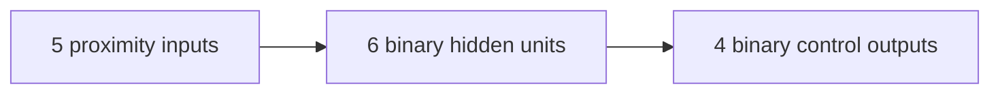

# Neural network: from sensors to controls

[Learning guide](README.md) · [Previous: simulation](simulation.md) · [Next: experiments](experiments.md)

## Feedforward structure

A feedforward network passes values through successive layers. Each output combines weighted inputs with a bias convention and an activation function. Outputs from one layer become inputs to the next. For the general model, see Poole and Mackworth's [Feedforward Neural Networks](https://www.cs.ubc.ca/~poole/aibook/3e/html/ArtInt3e.Ch8.S1.html).

In this repository, [Car](../assets/js/car.js) constructs `NeuralNetwork([this.sensor.rayCount, 6, 4], random)`, passing the experiment's random source. With the default five rays, the shape is:



[network.js](../assets/js/network.js) represents this as two `Level` objects: one for `5 -> 6` and one for `6 -> 4`. The five input values are the input layer, but do not require a separate `Level` object.

| Level | Weight matrix: inputs × outputs | Biases |
| --- | --- | --- |
| Sensor to hidden | `5 × 6` | `6` |
| Hidden to control | `6 × 4` | `4` |

There are `30 + 24 = 54` weights and `6 + 4 = 10` biases: 64 parameters in total. Input and output arrays store the latest activity; they are not additional parameters.

## Inputs and output meanings

`Car.update()` maps each sensor reading to a proximity input: `0` for a missing reading and `1 - offset` for a hit. Values nearer `1` indicate a nearby intersection along that ray. These values are normalized geometric distances, not probabilities or object labels. See the [sensor equations](simulation.md#sensor-rays).

The four outputs have a fixed order:

| Output index | Control field | Effect when active |
| --- | --- | --- |
| `0` | `forward` | Increase speed |
| `1` | `left` | Turn left while moving |
| `2` | `right` | Turn right while moving |
| `3` | `reverse` | Decrease speed |

The outputs are independent binary values, not a single winning class. Opposing controls can both activate; the movement code processes both. The network does not directly predict a lane, steering angle, velocity, or collision probability.

## Weighted sums and the threshold convention

For each output unit `j`, `Level.feedForward()` computes:

```text
sum[j] = Σ input[i] * weights[i][j]
output[j] = 1 if sum[j] > biases[j], otherwise 0
```

For a small illustrative unit with inputs `[0.75, 0.25]`, weights `[1, -1]`, and threshold `0.25`, the sum is `0.5`, so the output is `1`. If its threshold is instead `0.5`, the output is `0`: the comparison is strictly greater, not greater than or equal.

The field named `biases` acts as a threshold that is subtracted from the weighted sum. To compare with a textbook expression `activation(weightedSum + b)`, use `b = -biases[j]` and an activation that returns `1` only for positive arguments. A positive stored threshold makes activation harder.

Both hidden and output units use this hard binary step. There is no sigmoid, ReLU, softmax, or confidence score in this implementation.

## Initialization, inference, and learning

`Level.#randomize()` initializes every weight and threshold with `random() * 2 - 1`, giving values in `[-1, 1)`. The running simulation supplies a seeded random function through `Car`, `NeuralNetwork`, and `Level`. Existing constructor calls that omit it still default to `Math.random`. Each car gets a separate network. `NeuralNetwork.feedForward()` then evaluates the two levels in sequence on every update.

Inference overwrites the `inputs` and `outputs` activity arrays, but leaves weights and biases unchanged within an individual evaluation. Changing colors in the visualizer reflects current activity, not parameter learning.

Parameter learning is a separate operation. For example, gradient-based learning needs an objective and parameter updates; backpropagation computes derivatives through the network. These concepts are described in the [parameter-learning section of the textbook](https://www.cs.ubc.ca/~poole/aibook/3e/html/ArtInt3e.Ch8.S1.html). The hard step used here is discontinuous at its threshold and has zero derivative away from it, so applying ordinary gradient-based training would require reconsidering that choice.

Inference mode has no parameter update. Optional Evolution mode adds whole-controller evaluation, selection, cloning, and mutation between generations; it does not use target labels, a differentiable loss, backpropagation, or a gradient-based optimizer. The position-based leader remains separate from the peak-distance fitness winner. See [the implemented evolutionary search](evolution.md).

## Seeded initialization

[random.js](../assets/js/random.js) implements the 32-bit SplitMix variant documented in [bryc's public-domain PRNG implementations](https://github.com/bryc/code/blob/master/jshash/PRNGs.md#splitmix32). It advances an unsigned 32-bit state, mixes bits using shifts and integer multiplication, and maps the result to `[0, 1)`. A seed identifies the initial state; restarting it reproduces the sequence. The generator is for repeatable educational experiments, not cryptography.

One generator supplies all 64 parameters of each initial car, in population order, and continues supplying mutation draws across generations in Evolution mode. `Math.random` is not replaced globally. Reproduction depends on the algorithm, parameter-consumption order, and code version; a seed is not a portable trained-model format. See [random tests](../tests/random.test.cjs) for a pinned sequence and injected-source checks.

## Persistence and compatibility

[main.js](../assets/js/main.js) saves the leader's network as JSON under `bestBrain`. When saved loading is enabled, restarting or reloading applies a compatible saved model to the first car only. The other cars keep their seeded parameters, so a saved first car may not remain the leader.

`isValidBrain()` compares the loaded model to a fresh network's expected dimensions. It checks the number of levels, vector and matrix sizes, and finite numeric values. Invalid data or storage access errors leave the seeded model active and show a status message. Validation does not assess driving quality.

Disabling **Use saved network** skips the storage read entirely and retains saved data. Reproducing an experiment with loading enabled also requires the same saved parameters; the seed alone cannot reproduce that controller.

Save network serializes activity arrays as well as parameters. Save champion stores a completed controller snapshot whose activity arrays are reset to zero; its weights and biases are preserved exactly. Both use the existing compatible JSON shape. Once inference runs, those activity arrays are overwritten using new observations. Removing stored data affects the next restart or reload; it does not reset the active simulation.

## Inspecting decisions step by step

The **Leader telemetry** panel shows the current leader's ID, damage state, vertical position, simulation step, and simulated time (steps / 60). Its inputs come from the first level's latest `inputs` array; the four outputs come from the last level's `outputs` array. Inputs are displayed to three decimal places. Those outputs are the controls calculated for the next movement update, rather than the controls that produced the current position.

Pause and use **Step** to follow one fixed 1/60 s update at a time. Rendering callbacks without a complete step do not run new inference. At step zero, placeholders indicate that no new inference has run, even if the loaded JSON contains activity from a previous run. A damaged car still runs inference but remains motionless. Displayed activity does not change parameters. Evolution mode replaces the population between generations; the elite preserves champion parameters and the other copies are mutated.

## Reading the visualization

[Visualizer](../assets/js/visualizer.js) draws connections, activity, and bias rings. [getRGBA()](../assets/js/utils.js) uses yellow for positive values, blue for negative values, and magnitude as opacity. Zero is transparent. Output arrows follow the same forward, left, right, reverse order used by the controls.

The visualization shows the current leader's network. Since the leader can change, comparing two frames does not necessarily compare the same controller. To observe parameter stability, inspect a fixed car as shown in the [experiments](experiments.md#3-observe-activity-without-parameter-learning).

The [core tests](../tests/core.test.cjs) check layer dimensions, propagation, and the strict threshold rule. The [simulation tests](../tests/simulation.test.cjs) cover saved model compatibility and storage failures.
