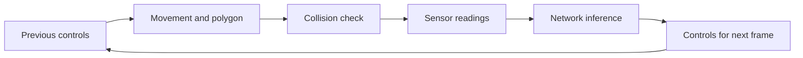

# Simulation: geometry and movement

[Learning guide](README.md) · [Next: neural network](neural-network.md)

## Coordinates and road geometry

Canvas coordinates increase to the right along `x` and downward along `y`. A car facing straight ahead has `angle = 0` and moves toward smaller `y` when its speed is positive.

[main.js](../assets/js/main.js) creates a 200-pixel-wide road canvas. [Road](../assets/js/road.js) receives center `100` and width `180`, so the road borders are at `x = 10` and `x = 190`. Three equal lanes have centers `40`, `100`, and `160`. The AI cars start at `(100, 100)`, and the traffic vehicle starts at `(100, -100)`.

The road looks infinite, but its border segments run from `y = -1000000` to `y = 1000000`. The camera translates the drawing so the leader remains about 70% down the road canvas; this translation does not change vehicle coordinates.

## What happens in one animation frame

When running, `animate()` in [main.js](../assets/js/main.js) calls `updateSimulation()`, then `renderSimulation()`. An update performs the following steps:

1. Update traffic vehicles first, including their collision polygons.
2. Update every AI car against the road borders and traffic polygons.
3. Select the first car whose `y` equals the smallest `y` in the population.

Rendering draws the road, traffic, cars, leader's sensors, and leader's neural network, then refreshes the telemetry panel. `animate()` always requests one next animation callback. While paused, it skips updates and keeps the dash animation frozen, but redraws for layout changes. **Step** performs exactly one update and redraw while remaining paused. **Restart** recreates the population, applies the seed and optional saved-model loading, and resets the step counter without changing the pause mode or creating another callback loop.

The constructor creates each car's initial polygon, so drawing a paused step-zero state does not require movement. At step zero, sensors and inference have not run; telemetry shows `—`, and the network canvas displays a prompt instead of stale saved activity.

Inside `Car.update()`, an undamaged car moves using its existing controls, builds its polygon, and checks damage. Its sensors then read the environment, and its network calculates controls for the next update. The first movement update therefore uses the initially false AI controls. Damaged cars keep updating sensors and inference, but their movement and polygon stop updating.



The leader is a position-based selection. There is no safety score or automatic restart, and damaged cars remain eligible. The 100 cars are processed in ordinary JavaScript loops, without worker threads. AI cars do not sense or collide with one another because the `traffic` array contains only the traffic vehicle.

## Repeatable initial conditions

`initializeSimulation()` creates a fresh generator from the applied seed and passes it through `generateCars()` to each car's neural network. A restart with unchanged seed, saved-model input, and code version therefore recreates the same initial parameters and positions. Pending field edits do not affect an active run. Seed validation happens before replacing its population.

The simulation consumes randomness during network initialization, not while moving. Compare states after equal update counts, using the same browser engine; frame-based wall-clock motion and cross-engine floating-point equality are separate concerns. See the [reproducibility exercise](experiments.md#7-repeat-a-seeded-experiment).

## Vehicle movement

[Car.#move()](../assets/js/car.js) applies acceleration, speed limits, friction, steering, and position changes in that order.

| Setting | Default AI car | Traffic vehicle |
| --- | --- | --- |
| Acceleration | `0.2` per update | `0.2` per update |
| Maximum forward speed | `3` | `2` |
| Maximum reverse magnitude | Half the forward limit | Half the forward limit |
| Friction | `0.05` per update | `0.05` per update |
| Steering increment | `0.03` radians per update | No steering input |

Forward increases speed; reverse decreases it. The speed is clamped before friction is applied. For example, a traffic car starting from rest reaches `0.2 - 0.05 = 0.15` on its first update. Values whose magnitude is below the friction threshold are set to zero.

At nonzero speed, left adds to the angle and right subtracts from it. Steering reverses its sign while reversing. Position then changes as follows:

```text
x_next = x - sin(angle) * speed
y_next = y - cos(angle) * speed
```

At `angle = 0`, these equations leave `x` unchanged and reduce `y` for a positive speed. Angles are in radians and distances are canvas units, not calibrated physical measurements.

Movement uses fixed increments per simulation update (one per running animation callback, or one per paused **Step**). The timestamp is used for the network's dashed-line animation, not for a physics time step. Consequently, changing callback frequency can change the simulated motion per second. The browser schedules callbacks around repainting and may pause them in background tabs; see [MDN's requestAnimationFrame documentation](https://developer.mozilla.org/en-US/docs/Web/API/Window/requestAnimationFrame).

## Sensor rays

[Sensor](../assets/js/sensor.js) casts five rays, each 150 units long, over a total spread of `PI / 2` radians (90 degrees). For an unrotated car, the rays run from its forward-left side toward its forward-right side; index `2` points straight ahead.

For ray index `i` among `n` rays:

```text
t = i / (n - 1)                  # t = 0.5 when n = 1
rayAngle = lerp(spread/2, -spread/2, t) + car.angle
end.x = car.x - sin(rayAngle) * rayLength
end.y = car.y - cos(rayAngle) * rayLength
```

`lerp(A, B, t)` in [utils.js](../assets/js/utils.js) computes `A + (B - A) * t`. Each ray is tested against road borders and each edge of every traffic polygon. The closest intersection is the reading; no intersection produces `null`.

The reported `offset` is the fraction of the ray traveled before a hit. A hit 60 units along a 150-unit ray has `offset = 0.4`. The car converts it to neural input `1 - 0.4 = 0.6`. A missing hit becomes `0`. A hit exactly at the ray endpoint also becomes `0`, so those two situations are indistinguishable to the controller.

In the sensor drawing, green marks the segment from the car to the hit, and red marks the remaining segment. Without a hit, the green portion spans the whole ray.

## Segment intersections and collisions

[getIntersection()](../assets/js/utils.js) solves for the intersection of two finite segments. If `A` and `B` define one segment and `C` and `D` define the other, a common point must satisfy:

```text
A + t * (B - A) = C + u * (D - C)
```

The function accepts the result only when both parameters are between `0` and `1`, including endpoints. It returns the intersection coordinates and `offset = t`, which is why calling it with a sensor ray first produces a normalized sensor distance.

`Car.#createPolygon()` computes four corners of the rotated rectangular car. `polysIntersection()` compares edges of that polygon with road border segments or traffic polygon edges. A detected crossing sets `damaged = true`; future updates leave the car's position fixed, and it is drawn gray.

These are simplified collision checks:

- A zero intersection denominator returns `null`, including collinear overlapping segments.
- Edge intersections alone do not detect a polygon entirely inside another polygon without an edge crossing.
- Checks use the position after each movement step, without a continuous sweep between positions. Very large steps could skip narrow obstacles.

The [core tests](../tests/core.test.cjs) exercise crossing, parallel, separated, and endpoint cases; nearest sensor hits; and cars stopping after border or traffic collisions. They do not establish complete collision coverage for every geometry.
